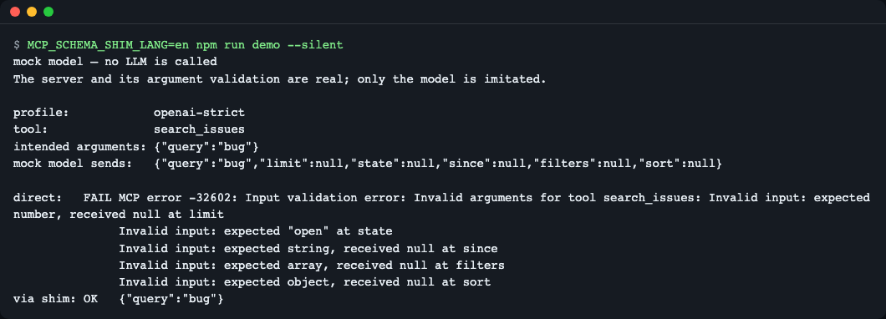
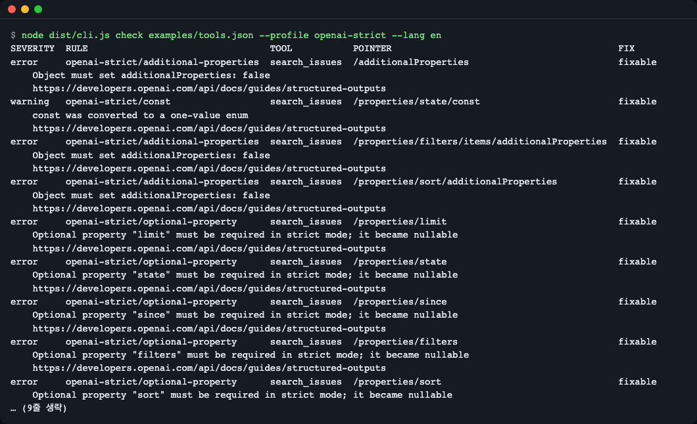
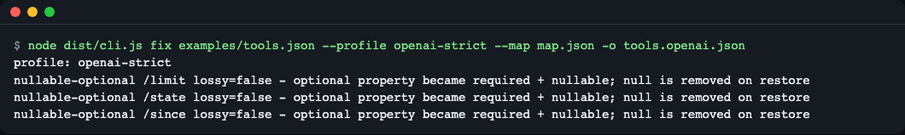
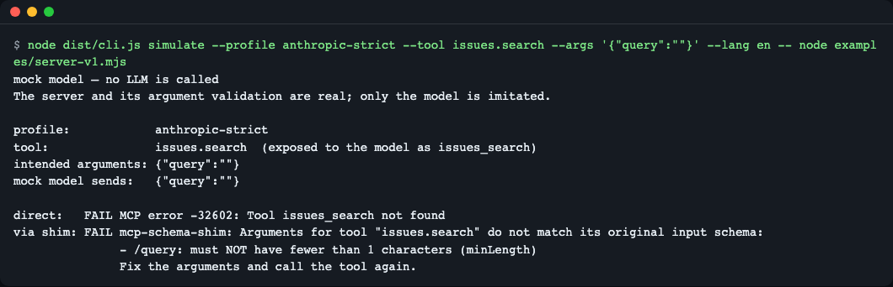
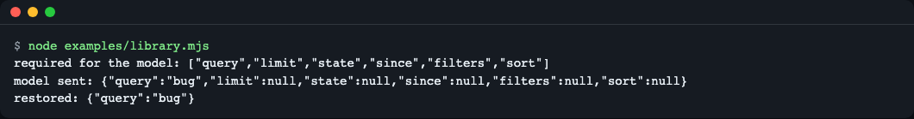
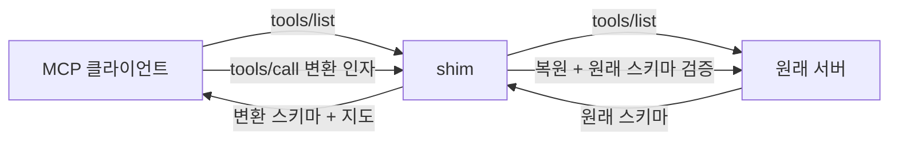
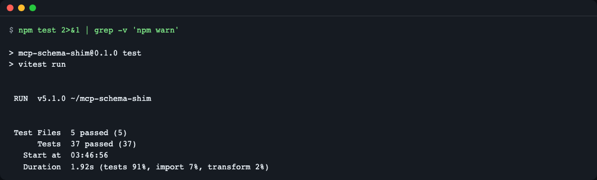

# mcp-schema-shim

**한국어** | [English](README.en.md)

> **English summary** — mcp-schema-shim checks MCP tool input schemas against the function-calling rules of Gemini, OpenAI strict mode and Anthropic strict tool use, rewrites them to fit, and restores the arguments the model sends back to the original schema shape (so `null` placeholders and renamed tools do not break your server). Use it as a stdio proxy in front of an MCP server, as a CI check, or as a library. Try it with no API key: `git clone https://github.com/LeeGyeongPil/mcp-schema-shim && cd mcp-schema-shim && npm install && npm run demo` (the demo uses a practice mock model; no LLM is called).

MCP 서버의 도구 정의(JSON Schema)를 모델 제공자(Gemini·OpenAI strict·Anthropic strict)가 받아 주는 모양으로 고쳐 주고, 모델이 고친 스키마대로 보낸 인자를 **원래 서버가 받는 모양으로 되돌려 주는** 도구입니다.


*연습용 목 모델이 만든 인자를 서버에 직접 보내면 `-32602` 로 거부되고, shim 을 거치면 통과한다.*

## 이런 분께
- 같은 MCP 서버를 Gemini·GPT·Claude 로 번갈아 쓰는데, 도구 하나 때문에 한 제공자의 요청 전체가 400 으로 막히는 분
- 서버 작성자로서 "내 도구 스키마를 어느 제공자가 왜 거부하는지"를 공식 문서 링크와 함께 CI 에서 확인하고 싶은 분
- 에이전트 프레임워크 코드 안에서 스키마를 바꾸고(`transformTools`) 모델이 보낸 인자를 되돌리고(`restore`) 싶은 분

## 왜 필요한가 (일상 비유)
통역사 두 명을 생각해 보세요. 제공자마다 "이 서식으로만 질문을 받는다"는 규칙이 다릅니다. 서식을 맞추려고 질문지를 고치면(예: 선택 항목을 전부 필수로 바꾸고 빈칸은 `null`), 이번에는 **원래 창구가 `null` 이 적힌 질문지를 거부**합니다. 이 도구는 질문지를 고쳐 주는 쪽과, 답이 돌아올 때 원래 서식으로 되돌려 주는 쪽을 한 쌍으로 묶은 어댑터입니다. "스키마만 고치면 끝"이 아니라는 것이 핵심입니다.

## 용어 사전
| 용어 | 뜻 |
|---|---|
| MCP `tools/list` | MCP 서버가 "내가 가진 도구 목록"을 알려 주는 요청. 도구마다 이름·설명·`inputSchema` 가 들어 있습니다. ([MCP 사양](https://modelcontextprotocol.io/specification)) |
| `inputSchema` | 도구가 받는 인자를 설명하는 JSON Schema. 모델은 이것을 보고 인자를 만듭니다. |
| strict mode | 제공자가 "스키마를 정확히 따르는 인자만 만든다"고 보장하는 대신, 스키마에 쓸 수 있는 키워드를 제한하는 모드(OpenAI·Anthropic). |
| 프로필(profile) | 제공자 한 경로의 규칙 묶음. 이 도구는 4개를 가집니다(아래 "프로필과 규칙"). |
| JSON 포인터 | 스키마 안의 위치를 `/properties/limit` 처럼 적는 방법. 진단표의 POINTER 열입니다. ([RFC 6901](https://www.rfc-editor.org/rfc/rfc6901)) |
| 변환 지도(map) | 스키마를 어떻게 바꿨는지 적은 기록. 인자를 되돌릴 때 씁니다. |
| `op` | 지도 항목의 종류(`nullable-optional`, `enum-stringified`, `name-mapped` 등). 아래 표 참고. |
| `lossy` | 변환 때 정보가 사라졌다는 표시. 사라진 제약은 마지막 원래 스키마 검증이 대신 지킵니다. |
| 인자 복원(restore) | 모델이 변환된 스키마대로 보낸 인자를 원래 스키마 모양으로 되돌리고 검증하는 단계. |
| `fixable` | 이 도구가 자동으로 고칠 수 있는 진단. `NOT fixable` 은 스키마를 직접 바꿔야 합니다. |

## 설치
전제: Node.js 20 이상(개발·테스트는 22.12 이상). 없으면 `brew install node` 또는 [nodejs.org](https://nodejs.org) 에서 설치합니다.

```bash
git clone https://github.com/LeeGyeongPil/mcp-schema-shim
cd mcp-schema-shim
npm install        # 설치 중 TypeScript 빌드(dist/)까지 실행됩니다
```

npm 레지스트리에는 아직 게시하지 않았습니다. 그래서 아래 예의 `npx mcp-schema-shim` 은 clone 한 폴더에서 `node dist/cli.js` 로 바꿔 쓰세요. 최소 리눅스 환경에서는 `git`, `node`, `npm` 만 있으면 됩니다.

## 빠르게 시작하기 (30초, 연습용 목 모드)
```bash
npm run demo
```

*`npm run demo` 의 실제 출력.*

- 첫 줄 `mock model — no LLM is called` : **연습용 목(mock) 모델**입니다. 실제 모델·API 키·네트워크를 쓰지 않고, OpenAI strict 모드의 모델이 보낼 법한 인자(`limit: null` 등)를 흉내 내 만듭니다.
- 진짜인 것: 예제 MCP 서버와 서버의 인자 검증. 그래서 `direct: FAIL ... received null` 은 실제 서버가 낸 오류입니다.
- 실제 모델과 다른 점: 모델이 어떤 인자를 고를지는 흉내일 뿐이며, 제공자 API 가 스키마를 받아 주는지는 호출하지 않았으므로 확인하지 않습니다.

## 사용법
| 명령 | 하는 일 | 예 |
|---|---|---|
| `check <tools.json> --profile <id>` / `--all` | 제공자 규칙 위반을 진단표로 출력(오류가 있으면 exit 1) | `node dist/cli.js check examples/tools.json --all` |
| `fix <tools.json> --profile <id> [--map f] [-o f]` | 변환된 도구 JSON 과 변환 지도 저장 | `node dist/cli.js fix examples/tools.json --profile openai-strict --map map.json` |
| `proxy --profile <id> -- <서버 명령>` | stdio MCP 서버 앞에 끼우는 프록시 | `node dist/cli.js proxy --profile gemini-parameters -- node examples/server-v1.mjs` |
| `simulate --profile <id> [--tool n] [--args json] -- <서버 명령>` | 목 모델로 직결 vs shim 경유 비교 | `npm run demo` |

종료 코드: `0` 정상, `1` 오류 등급 진단(check) 또는 못 고치는 오류(fix), `2` 입력·사용법 오류. `simulate` 는 비교 결과(`via shim: FAIL` 포함)와 무관하게 `0`, 입력 오류만 `2` 입니다. 입력 파일은 `{"tools":[…]}`(`tools/list` 결과) 또는 도구 배열입니다.

프로필: `gemini-parameters`(옛 `parameters` 필드, OpenAPI 부분집합), `gemini-json-schema`(`parametersJsonSchema`), `openai-strict`, `anthropic-strict`.

### 1) 검사하기 — 무엇이 거부되나
```bash
node dist/cli.js check examples/tools.json --profile openai-strict
```

*규칙 ID, 도구 이름, JSON 포인터(`/properties/limit`), 자동 수정 가능 여부, 공식 문서 URL 이 한 줄씩 나온다. 이 예는 10 오류·1 경고라서 exit 1.*

읽는 법: `fixable` 이면 `fix`/프록시가 고칠 수 있다는 뜻입니다. `NOT fixable` 은 사람이 스키마를 바꿔야 합니다. `--all --format markdown` 으로 모든 프로필 결과를 표로 받아 CI 에 붙일 수 있습니다(예제 도구 기준 합계 `22 error(s), 5 warning(s), 2 info`).

### 2) 고치고 변환 지도 보기
```bash
node dist/cli.js fix examples/tools.json --profile openai-strict --map map.json -o tools.openai.json
```

*지도(`map.json`)에는 무엇을 어떻게 바꿨고(`op`), 되돌릴 때 손실이 있는지(`lossy`)가 기록된다.*

### 3) 이름 변환과 원래 스키마 재검증
```bash
node dist/cli.js simulate --profile anthropic-strict --tool issues.search -- node examples/server-v1.mjs
```

*`issues.search` 는 모델에게 `issues_search` 로 보이고(Anthropic 이름 규칙), 서버에는 원래 이름으로 전달된다. 이 화면은 `--args '{"query":""}'` 를 준 실행이라 원래 스키마 위반 이유(`/query`)도 보인다.*

`--args` 로 원래 스키마(`minLength: 1`)를 어기는 인자를 주면, shim 은 서버에 보내지 않고 `/query` 가 왜 틀렸는지를 돌려줍니다. 설명으로 옮긴 제약(`minLength` 등)은 이 마지막 검증이 지킵니다.

```bash
node dist/cli.js simulate --profile anthropic-strict --tool issues.search --args '{"query":""}' -- node examples/server-v1.mjs
```
```
direct:   FAIL MCP error -32602: Tool issues_search not found
via shim: FAIL mcp-schema-shim: Arguments for tool "issues.search" do not match its original input schema:
         - /query: must NOT have fewer than 1 characters (minLength)
         Fix the arguments and call the tool again.
```
(위는 출력 중 마지막 두 단락만 옮긴 것입니다. `direct` 는 서버에 변환된 이름 `issues_search` 로 직접 보냈기 때문에 실패합니다.)

### 4) 클라이언트에 끼우기
MCP 클라이언트 설정에서 서버 항목의 `command` 를 shim 으로 감쌉니다(경로는 본인 clone 위치로):

```json
{
  "mcpServers": {
    "my-server": {
      "command": "node",
      "args": ["/path/to/mcp-schema-shim/dist/cli.js", "proxy", "--profile", "gemini-parameters",
               "--", "npx", "-y", "<원래 서버 패키지>"]
    }
  }
}
```
프록시는 `tools/list` 응답과 `tools/call` 요청만 해석하고, 나머지 줄은 그대로 전달합니다. 직접 확인:

```bash
printf '{"jsonrpc":"2.0","id":1,"method":"ping"}\n' | node dist/cli.js proxy --profile openai-strict -- node examples/server-v1.mjs
```
```
{"result":{},"jsonrpc":"2.0","id":1}
```
변환 로그는 `--log <파일>` 로 남길 수 있습니다(못 고치는 도구는 `NOT fixable` 로 기록).

### 5) 라이브러리로 쓰기
아직 npm 에 게시하지 않았으므로 다른 프로젝트에서는 clone 한 폴더 경로로 설치합니다: `npm install /path/to/mcp-schema-shim`. 아래 코드에서 `tools` 는 `tools/list` 결과 배열, `fromModel` 은 모델이 보낸 인자입니다. 바로 실행되는 완전한 예는 `examples/library.mjs` 입니다.
```ts
import { transformTools, restore } from "mcp-schema-shim";

const { tools: forModel, map } = transformTools(tools, "openai-strict");
// forModel 을 모델에 넘기고, 모델이 보낸 호출은 되돌린다:
const restored = restore("search_issues", fromModel, map);
// restored.args 는 원래 스키마로 검증된 인자. 어기면 RestoreError(issues[]) 를 던진다.
```
```bash
node examples/library.mjs
```

*모델이 보낸 `null` 이 채워진 인자가 `{"query":"bug"}` 로 복원된다.*

공개 API(`src/index.ts` 의 내보내기 전부):

| 이름 | 종류 | 설명 |
|---|---|---|
| `check(tools, profile)` | 함수 | 진단 목록(`Diagnostic[]`)만 돌려줍니다. |
| `transformTool(tool, profile, opts?)` | 함수 | 도구 하나를 변환하고 그 도구의 지도를 만듭니다. |
| `transformTools(tools, profile, opts?)` | 함수 | 도구 목록을 변환하고 `{ tools, map, diagnostics }` 를 돌려줍니다. |
| `restore(name, args, map)` | 함수 | 모델이 보낸 인자를 되돌리고 원래 스키마로 검증합니다. |
| `PROFILES` | 상수 | 프로필 4개의 설명·문서 URL·규칙 목록. |
| `PROFILE_IDS` | 상수 | 프로필 ID 배열. |
| `isProfileId(x)` | 함수 | 값이 프로필 ID 인지 판별하는 타입 가드. |
| `RestoreError` | 오류 | 복원한 인자가 원래 스키마를 어길 때(`issues[]` 포함). |
| `UnknownToolError` | 오류 | 지도에 없는 도구 이름으로 `restore` 할 때. |
| `InputError` | 오류 | 잘못된 도구 파일·프로필 이름 등 입력 오류. |
| `DOCS_CHECKED` | 상수 | 규칙의 공식 문서를 확인한 날짜. |
| 타입 | 타입 | `ProfileId`, `JsonSchema`, `McpTool`, `Severity`, `Diagnostic`, `MapOp`, `MapEntry`, `ToolMap`, `ShimMap`, `TransformOptions`, `TransformResult`, `TransformToolResult`, `RestoreIssue`, `ProfileInfo`, `RuleDef` |

## 설정
설정 파일·환경변수·API 키는 없습니다. 동작은 `--profile` 과 위 옵션으로만 정해집니다. 규칙 전체 목록(규칙마다 공식 문서 URL·확인 날짜)은 [docs/rules.md](docs/rules.md) 에 있습니다.

## 프로필과 규칙
프로필은 "어느 제공자의 어느 경로로 보낼 것인가"입니다. `--profile` 로 고릅니다.

| 프로필 | 대상 | 대표 규칙 |
|---|---|---|
| `gemini-parameters` | Gemini 함수 선언의 옛 `parameters` 필드(OpenAPI 부분집합). 도구 하나가 틀리면 요청 전체가 실패합니다. | `$ref` 펼치기, `const`/숫자 enum 문자열화, `type: ["string","null"]` 를 `nullable` 로 |
| `gemini-json-schema` | 새 `parametersJsonSchema` 필드(진짜 JSON Schema). 변환이 거의 필요 없습니다. | 루트 `type: object` 확인, 외부 `$ref` 오류, `minLength` 무시 안내 |
| `openai-strict` | OpenAI `strict: true` 함수 호출 | 모든 객체에 `additionalProperties: false`, 선택 필드를 필수 + `null` 허용으로, 자유형 객체는 고칠 수 없음 |
| `anthropic-strict` | Anthropic strict 도구 사용 | `minLength`·`minimum`·배열 제약(`maxItems`·`uniqueItems`·`minItems` 2 이상)·지원 목록 밖 `format`·`\b` 패턴을 설명으로 옮기기, 도구 이름 `^[a-zA-Z0-9_-]{1,128}$` 로 바꾸기 |

규칙마다 심각도(error·warning·info), 자동 수정 여부, 공식 문서 URL 이 있고 전체는 [docs/rules.md](docs/rules.md) 에 있습니다. 규칙은 문서를 읽은 날(2026-11-10) 기준입니다.

## 변환 지도와 복원
변환 지도의 항목은 `op` 종류별로 복원 동작이 다릅니다.

| `op` | 변환 내용 | 복원(restore) 동작 |
|---|---|---|
| `nullable-optional` | 선택 필드를 필수 + `null` 허용으로 바꿈(OpenAI) | 값이 `null` 인 필드를 지워 "보내지 않음"으로 되돌림. 원래 스키마가 `null` 을 허용하면 기록하지 않고 `null` 유지 |
| `enum-stringified` | `const`/숫자 enum 을 문자열로 바꿈(Gemini) | 지도의 `values` 로 원래 값(숫자 등)을 되돌림 |
| `name-mapped` | 도구 이름을 제공자 규칙에 맞게 바꿈(`issues.search` → `issues_search`) | 원래 이름으로 되돌려 서버에 전달 |
| `constraint-to-description` | `minLength`·`format` 등을 설명 문장으로 옮김(lossy) | 되돌릴 값은 없고, 마지막 원래 스키마 검증이 제약을 지킴 |
| `dropped` | 지원하지 않는 키워드를 삭제(lossy) | 위와 같음 |
| `all-of-merged` | `allOf` 객체 가지를 한 객체로 합침 | 위와 같음(정보 손실 없음) |
| `one-of-to-any-of` | `oneOf` 를 `anyOf` 로 바꿈(lossy) | 위와 같음(배타성은 원래 스키마가 검사) |

복원의 마지막 단계는 항상 **원래 스키마로 검증**입니다. 그래서 설명으로 옮기거나 삭제한 제약도 서버에 닿기 전에 걸러집니다. 한계로, 검증 실패는 모델에게 `isError` 결과로 돌아가 다시 시도하게 하는 방식이라 모델이 고칠 수 없는 경우에는 반복될 수 있습니다.

## 동작 원리

1. 서버의 도구 목록을 받으면, 선택한 프로필 규칙으로 스키마를 변환하고 "무엇을 바꿨는지" 지도를 만듭니다.
2. 클라이언트(모델)는 변환된 스키마만 봅니다.
3. 호출이 오면 지도로 `null` 제거·`const`/enum 문자열 되돌리기·이름 복원을 하고, **원래 스키마로 다시 검증**한 뒤에만 서버에 보냅니다.
4. 검증에 실패하면 서버 대신 `isError` 결과로 이유를 돌려줘 모델이 다시 시도할 수 있게 합니다.

`check` 와 `fix` 와 프록시는 같은 규칙 엔진을 쓰므로, `check` 가 `fixable` 이라 한 것은 `fix` 가 반드시 고칩니다.

## 코드 둘러보기
```
src/
  profiles/   제공자별 규칙(gemini-parameters·gemini-json-schema·openai-strict·anthropic-strict)과 공통 도구(common.ts)
  rules/      규칙 목록과 공식 문서 URL(registry.ts, docs.ts)
  check.ts    변환을 돌려 진단만 취함
  transform.ts  도구 변환 + 변환 지도 만들기, 이름 충돌 처리
  restore.ts  지도로 인자 되돌리기 + 원래 스키마(ajv)로 검증
  proxy/      stdio JSON-RPC 프록시(proxy.ts, jsonrpc.ts)
  simulate.ts  목 모델로 직결과 경유 비교(sample.ts 가 인자 생성)
  cli.ts      check·fix·proxy·simulate 명령
```
호출 흐름은 이렇습니다.

1. `profiles/*.ts` 의 `transformSchema` 가 스키마를 훑으면서 진단(`ctx.emit`)과 변환·지도 기록(`ctx.record`)을 **같은 코드**에서 합니다. 그래서 `check`·`fix`·프록시의 판단이 어긋나지 않습니다(`src/check.ts`, `src/transform.ts`).
2. `src/transform.ts` 의 `transformTools` 가 도구 목록 전체를 변환하고 지도를 만듭니다. 바뀌지 않는 이름을 먼저 예약해 이름 충돌을 피합니다.
3. `src/restore.ts` 가 지도 항목을 적용(null 제거·enum 되돌림·이름 복원)한 뒤 원래 스키마로 검증합니다. 실패하면 `RestoreError`.
4. `src/proxy/proxy.ts` 가 `tools/list` 응답은 변환하고 `tools/call` 요청은 `restore` 하며, 나머지 줄은 그대로 전달합니다.

## 한계
- stdio 전송만 지원합니다(HTTP/SSE 프록시 없음).
- 자유형 객체와 재귀 `$ref` 는 `openai-strict`·`anthropic-strict` 에서 못 고치는 오류, `gemini-parameters` 에서는 재귀 `$ref` 가 못 고치는 오류입니다.
- 원래 스키마가 이미 `null` 을 허용하는 선택 필드는 `null` 을 그대로 둡니다(없음과 `null` 을 구분할 수 없음).
- 첫 `tools/list` 이전에 온 `tools/call` 은 복원 없이 통과합니다(실제 클라이언트는 먼저 목록을 요청합니다).
- 규칙은 2026-11-10 에 읽은 제공자 문서 기준이며 실제 API 로 검증하지 않았습니다. 제공자 규칙은 바뀔 수 있습니다.

## 언제 쓰나
- 모델이 보낸 인자를 원래 스키마로 되돌려 검증해야 할 때(라이브러리 함수 `restore` 로 복원하고, CLI 명령 `simulate` 로 왕복 결과를 확인).
- 기존 MCP 서버 앞에 stdio 프록시로 끼워 제공자별 스키마 규칙을 맞추고 싶을 때(`proxy`).
- 스키마 검사·변환만 필요하다면 [tool-schema](https://github.com/slegarraga/tool-schema) 도 살펴보세요.

## 직접 바꿔 보기
1. **프로필 바꾸기** — 바꿀 곳: `check` 의 `--profile` 을 `gemini-json-schema` 로. 예상: 오류·경고 없이 `minLength` 무시 안내(info) 2건만 나오고 종료 코드가 0 입니다. 확인: 표의 마지막 줄 `0 error(s), 0 warning(s), 2 info`.
2. **예제 도구 수정** — 바꿀 곳: `examples/tools.json` 의 `limit` 두 곳에 `"multipleOf": 5` 를 추가. 예상: `check examples/tools.json --profile anthropic-strict` 의 마지막 줄이 `8 error(s)` 에서 `10 error(s)` 로 늘고(`unsupported-constraint`), `fix --map` 지도에 `constraint-to-description` 항목이 생깁니다. 확인: 표의 마지막 줄과 `map.json`.
3. **복원 시험** — 바꿀 곳: `node dist/cli.js simulate --profile openai-strict --tool search_issues --args '{"query":"x","limit":0}' -- node examples/server-v1.mjs` 처럼 `limit` 을 0 으로. 예상: `limit` 은 원래 스키마에서 `minimum: 1` 이라서 `via shim: FAIL` 과 `/limit: must be >= 1 (minimum)` 이 나옵니다. 확인: 출력 마지막 세 줄.

## 자주 겪는 문제
| 증상 | 원인 | 해결 |
|---|---|---|
| `Cannot find module .../dist/cli.js` | 빌드가 안 됨 | `npm run build` |
| `fix` 가 exit 1 | 못 고치는 오류(재귀 `$ref`, 자유형 객체) 존재 | `check` 표의 `NOT fixable` 줄을 보고 스키마 수정 또는 다른 프로필 선택 |
| `npm test` 가 버전 오류 | vitest 가 Node 22.12 이상 요구 | Node 업데이트(런타임만 쓰면 20 이상) |
| `npm run demo` 의 직결이 항상 FAIL | 의도된 결과 | 직결 실패를 보여 주는 장면입니다 |

## 개발·기여
```bash
npm test
```

*키·네트워크 없이 v1·v2 TypeScript SDK 서버 종단 시험까지 통과한다.*

버그·제안은 이슈로 남겨 주세요. 변경 기록은 [CHANGELOG.md](CHANGELOG.md).

## 더 알아보기
- OpenAI Structured Outputs: https://developers.openai.com/api/docs/guides/structured-outputs (2026-11-10 확인)
- Anthropic Structured Outputs: https://platform.claude.com/docs/en/build-with-claude/structured-outputs (2026-11-10 확인)
- Gemini function calling: https://aistudio.google.com/docs/function-calling (2026-11-10 확인)

## 라이선스
MIT. 외부 모델·데이터는 포함하지 않습니다.
