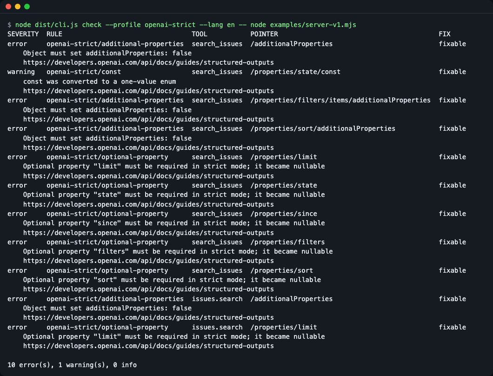
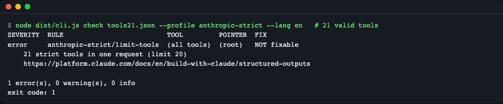
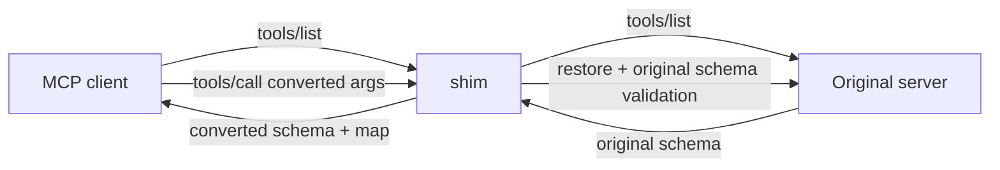

# mcp-schema-shim

**English** | [한국어](README.ko.md)

mcp-schema-shim checks MCP tool input schemas against the function-calling rules of Gemini, OpenAI strict mode and Anthropic strict tool use, rewrites them to fit, and restores the arguments the model sends back to the original schema shape (so `null` placeholders and renamed tools do not break your server). Use it as a stdio proxy in front of an MCP server, as a CI check, or as a library. Try it with no API key: `git clone https://github.com/LeeGyeongPil/mcp-schema-shim && cd mcp-schema-shim && npm install && npm run demo` (the demo uses a practice mock model; no LLM is called).


*Sending the arguments made by the practice mock model straight to the server is rejected with `-32602`; going through the shim passes.*

## Who it is for
- People who use the same MCP server with Gemini, GPT and Claude in turn, but where one tool blocks one provider's whole request with a 400
- Server authors who want CI to show, with official documentation links, which provider rejects their tool schema and why
- People who want to rewrite schemas (`transformTools`) and restore the arguments the model sent (`restore`) inside agent framework code

## Why it is needed (an everyday analogy)
Think of two interpreters. Each provider has a different rule: "we accept questions only in this format." If you rewrite the questionnaire to fit the format (for example, make every optional item required and fill blanks with `null`), then **the original service desk rejects a questionnaire with `null` written in it**. This tool is an adapter that pairs the side that rewrites the questionnaire with the side that turns the answer back into the original format. The key point is that "just fixing the schema" is not the end of it.

## Glossary
| Term | Meaning |
|---|---|
| MCP `tools/list` | The request in which an MCP server reports "the list of tools I have". Each tool carries a name, a description and an `inputSchema`. ([MCP specification](https://modelcontextprotocol.io/specification)) |
| `inputSchema` | The JSON Schema describing the arguments a tool accepts. The model builds arguments by looking at it. |
| strict mode | A mode (OpenAI, Anthropic) in which the provider guarantees that it produces only arguments that follow the schema exactly, in exchange for restricting the keywords usable in the schema. |
| profile | A bundle of rules for one provider path. This tool has 4 (see "Profiles and rules" below). |
| JSON pointer | A way of writing a location inside a schema, like `/properties/limit`. It is the POINTER column of the diagnostics table. ([RFC 6901](https://www.rfc-editor.org/rfc/rfc6901)) |
| conversion map (map) | A record of how the schema was changed. Used when restoring arguments. |
| `op` | The kind of a map entry (`nullable-optional`, `enum-stringified`, `name-mapped`, etc.). See the table below. |
| `lossy` | A mark that information was lost in the conversion. Lost constraints are enforced instead by the final validation against the original schema. |
| argument restore (restore) | The step that turns arguments the model sent in the converted schema's shape back into the original schema's shape and validates them. |
| `fixable` | A diagnostic this tool can fix automatically. `NOT fixable` means you must change the schema yourself. |

## Installation
Prerequisite: Node.js 20 or later (22.12 or later for development and tests). If you do not have it, install it with `brew install node` or from [nodejs.org](https://nodejs.org).

```bash
git clone https://github.com/LeeGyeongPil/mcp-schema-shim
cd mcp-schema-shim
npm install        # the TypeScript build (dist/) also runs during install
```

It has not been published to the npm registry yet. So replace `npx mcp-schema-shim` in the examples below with `node dist/cli.js` in the cloned folder. On a minimal Linux environment, only `git`, `node` and `npm` are needed.

## Quick start (30 seconds, practice mock mode)
```bash
npm run demo
```

*The actual output of `npm run demo`.*

- First line `mock model — no LLM is called`: this is a **practice mock model**. It uses no real model, API key or network, and imitates the arguments an OpenAI strict-mode model might send (such as `limit: null`).
- What is real: the example MCP server and the server's argument validation. So `direct: FAIL ... received null` is an actual error raised by the server.
- How it differs from a real model: which arguments the model picks is only imitated, and whether the provider API accepts the schema is not checked because it is not called.

## Usage
| Command | What it does | Example |
|---|---|---|
| `check <tools.json> --profile <id>` / `--all` | Print provider rule violations as a diagnostics table (exit 1 if there are errors) | `node dist/cli.js check examples/tools.json --all` |
| `check --profile <id>` / `--all` `[--timeout ms]` `-- <server command>` | Same check, but fetch `tools/list` (all pages) from a stdio server you start | `node dist/cli.js check --profile openai-strict -- node examples/server-v1.mjs` |
| `fix <tools.json> --profile <id> [--map f] [-o f]` | Save the converted tools JSON and the conversion map | `node dist/cli.js fix examples/tools.json --profile openai-strict --map map.json` |
| `proxy --profile <id> -- <server command>` | A proxy placed in front of a stdio MCP server | `node dist/cli.js proxy --profile gemini-parameters -- node examples/server-v1.mjs` |
| `simulate --profile <id> [--tool n] [--args json] -- <server command>` | Compare direct vs via shim with a mock model | `npm run demo` |

Since 0.3.0, a large server can fail `check` with exit 1 under `anthropic-strict`: more than 20 tools (`anthropic-strict/limit-tools`) or more than 24 optional parameters in total (`anthropic-strict/limit-optional`) are rejected by the API, so they are reported as `(all tools)` errors that `fix` cannot repair. The messages read `21 strict tools in one request (limit 20)` and `25 optional parameters across all strict tool schemas (limit 24)`.

Exit codes: `0` normal, `1` error-level diagnostics (check) or an unfixable error (fix), `2` input or usage error (with a server command, also when the server cannot be started, times out or answers with an error). `simulate` returns `0` regardless of the comparison result (including `via shim: FAIL`), and `2` only for input errors. The input file is `{"tools":[…]}` (the `tools/list` result) or an array of tools (file mode), or a stdio server command after `--` (server mode).

Profiles: `gemini-parameters` (the old `parameters` field, an OpenAPI subset), `gemini-json-schema` (`parametersJsonSchema`), `openai-strict`, `anthropic-strict`.

### 1) Check — what gets rejected
```bash
node dist/cli.js check examples/tools.json --profile openai-strict
```

*Each line shows the rule ID, tool name, JSON pointer (`/properties/limit`), whether it can be fixed automatically, and the official documentation URL. This example has 10 errors and 1 warning, so exit 1.*

How to read it: `fixable` means `fix` or the proxy can fix it. `NOT fixable` means a person has to change the schema. With `--all --format markdown` you can get the results of all profiles as a table and paste it into CI (for the example tools the total is `22 error(s), 5 warning(s), 2 info`).

Instead of a file you can check a running server directly: put its start command after `--`. `check` starts it, reads every `tools/list` page, stops it, and prints the same table.
```bash
node dist/cli.js check --profile openai-strict -- node examples/server-v1.mjs
npx mcp-schema-shim check --all --format markdown -- node build/server.js
```

*`check` started the example server, read its tool list and printed the same table (exit 1 because there are errors).*


*A list of 21 valid tools passes every per-tool rule, but `check` reports `anthropic-strict/limit-tools` (the request limit is 20) and exits 1.*

In CI one line is enough: `npx mcp-schema-shim check --profile openai-strict -- node build/server.js` (the step fails on exit 1). The server's own log lines go to stderr, so `--format json` on stdout stays valid.

### 2) Fix and view the conversion map
```bash
node dist/cli.js fix examples/tools.json --profile openai-strict --map map.json -o tools.openai.json
```

*The map (`map.json`) records what was changed and how (`op`), and whether restoring loses anything (`lossy`).*

### 3) Name conversion and re-validation against the original schema
```bash
node dist/cli.js simulate --profile anthropic-strict --tool issues.search -- node examples/server-v1.mjs
```

*`issues.search` appears to the model as `issues_search` (Anthropic's naming rule) and is passed to the server under its original name. This screen is a run with `--args '{"query":""}'`, so the reason for the original-schema violation (`/query`) is also visible.*

If you give `--args` arguments that violate the original schema (`minLength: 1`), the shim does not send them to the server and returns why `/query` is wrong. Constraints moved into descriptions (`minLength` and so on) are enforced by this final validation.

```bash
node dist/cli.js simulate --profile anthropic-strict --tool issues.search --args '{"query":""}' -- node examples/server-v1.mjs
```
```
direct:   FAIL MCP error -32602: Tool issues_search not found
via shim: FAIL mcp-schema-shim: Arguments for tool "issues.search" do not match its original input schema:
               - /query: must NOT have fewer than 1 characters (minLength)
               Fix the arguments and call the tool again.
```
(The above is only the last two paragraphs of the output. `direct` fails because it sent the converted name `issues_search` straight to the server.)

### 4) Plugging it into a client
In your MCP client configuration, wrap the server entry's `command` with the shim (use your own clone location for the path):

```json
{
  "mcpServers": {
    "my-server": {
      "command": "node",
      "args": ["/path/to/mcp-schema-shim/dist/cli.js", "proxy", "--profile", "gemini-parameters",
               "--", "npx", "-y", "<원래 서버 패키지>"]
    }
  }
}
```
(`<원래 서버 패키지>` is a placeholder for "the original server package".)

The proxy interprets only `tools/list` responses and `tools/call` requests, and passes every other line through unchanged. Check it yourself:

```bash
printf '{"jsonrpc":"2.0","id":1,"method":"ping"}\n' | node dist/cli.js proxy --profile openai-strict -- node examples/server-v1.mjs
```
```
{"result":{},"jsonrpc":"2.0","id":1}
```
You can keep a conversion log with `--log <file>` (tools that cannot be fixed are recorded as `NOT fixable`).

### 5) Using it as a library
It is not published to npm yet, so from another project install it by the cloned folder's path: `npm install /path/to/mcp-schema-shim`. In the code below, `tools` is the array from the `tools/list` result and `fromModel` is the arguments the model sent. A complete example you can run right away is `examples/library.mjs`.
```ts
import { transformTools, restore } from "mcp-schema-shim";

const { tools: forModel, map } = transformTools(tools, "openai-strict");
// Pass forModel to the model, and turn the calls the model sends back:
const restored = restore("search_issues", fromModel, map);
// restored.args are the arguments validated against the original schema. If they violate it, RestoreError(issues[]) is thrown.
```
```bash
node examples/library.mjs
```

*The arguments the model sent with `null` filled in are restored to `{"query":"bug"}`.*

Public API (everything exported from `src/index.ts`):

| Name | Kind | Description |
|---|---|---|
| `check(tools, profile)` | function | Returns only the list of diagnostics (`Diagnostic[]`). |
| `transformTool(tool, profile, opts?)` | function | Converts one tool and builds that tool's map. |
| `transformTools(tools, profile, opts?)` | function | Converts a list of tools and returns `{ tools, map, diagnostics }`. |
| `restore(name, args, map)` | function | Restores the arguments the model sent and validates them against the original schema. |
| `PROFILES` | constant | Descriptions, documentation URLs and rule lists of the 4 profiles. |
| `PROFILE_IDS` | constant | Array of profile IDs. |
| `isProfileId(x)` | function | A type guard that tells whether a value is a profile ID. |
| `RestoreError` | error | When the restored arguments violate the original schema (includes `issues[]`). |
| `UnknownToolError` | error | When you `restore` with a tool name that is not in the map. |
| `InputError` | error | Input errors such as a bad tools file or profile name. |
| `DOCS_CHECKED` | constant | The date the rules' official documentation was checked. |
| Types | types | `ProfileId`, `JsonSchema`, `McpTool`, `Severity`, `Diagnostic`, `MapOp`, `MapEntry`, `ToolMap`, `ShimMap`, `TransformOptions`, `TransformResult`, `TransformToolResult`, `RestoreIssue`, `ProfileInfo`, `RuleDef` |

## Configuration
There are no configuration files or API keys. The only environment variables choose the screen language (see below). Behavior is set by `--profile` and the options above. With a server command, `--timeout <ms>` (default `10000`) is how long `check` waits for each answer; it is an error in file mode. The full rule list (with an official documentation URL and check date for each rule) is in [docs/rules.md](docs/rules.md).

### Screen language (English / Korean)
The CLI shows its help, reports, errors and `simulate` output in English or Korean. The language is picked in this order, and the first one that is set wins:

1. `--lang en|ko` (any other value exits 2 with one error line)
2. the `MCP_SCHEMA_SHIM_LANG` environment variable
3. `LC_ALL`, then `LC_MESSAGES`, then `LANG` (a value starting with `ko`, such as `ko_KR.UTF-8`, means Korean)
4. otherwise English

```bash
node dist/cli.js check examples/tools.json --profile openai-strict --lang ko
MCP_SCHEMA_SHIM_LANG=ko node dist/cli.js simulate --profile openai-strict -- node examples/server-v1.mjs
LANG=ko_KR.UTF-8 node dist/cli.js check examples/tools.json --profile openai-strict
```

`--format json` output, rule IDs and exit codes are the same in both languages, so scripts are not affected. In `simulate`, only the banner and labels (`direct`, `via shim`, `FAIL`/`OK`) change language; the MCP tool-result text returned by the server and the proxy (the response a model reads, such as `MCP error ...` and `Arguments for tool ...`) stays English in both languages. In Korean, each finding in the text and markdown reports is described by a Korean one-line summary per rule; the diagnostic text in JSON and the proxy log lines stay English.

An unrecognized `MCP_SCHEMA_SHIM_LANG` value (anything other than `en`/`ko`, for example `xx`) is ignored without a warning and the CLI shows English; only `--lang` rejects bad values.

## Profiles and rules
A profile is "which provider, through which path, you will send to". Pick it with `--profile`.

| Profile | Target | Representative rules |
|---|---|---|
| `gemini-parameters` | The old `parameters` field of Gemini function declarations (an OpenAPI subset). If one tool is wrong, the whole request fails. | Inline `$ref`, stringify `const`/numeric enums, turn `type: ["string","null"]` into `nullable` |
| `gemini-json-schema` | The new `parametersJsonSchema` field (real JSON Schema). Almost no conversion is needed. | Confirm root `type: object`, error on external `$ref`, notice that `minLength` is ignored |
| `openai-strict` | OpenAI `strict: true` function calling | `additionalProperties: false` on every object, optional fields become required + nullable, free-form objects cannot be fixed |
| `anthropic-strict` | Anthropic strict tool use | Move `minLength`, `minimum`, array constraints (`maxItems`, `uniqueItems`, `minItems` of 2 or more), `format` outside the supported list and `\b` patterns into descriptions; rename tools to `^[a-zA-Z0-9_-]{1,128}$`. Request limits: at most 20 strict tools and 24 optional parameters per request (NOT fixable) |

Each rule has a severity (error, warning, info), whether it is auto-fixable, and an official documentation URL; the full list is in [docs/rules.md](docs/rules.md). The rules are as of the day the documentation was read (2026-11-10); the two request limits (20 strict tools, 24 optional parameters) were checked separately against the Anthropic Structured Outputs documentation on 2026-11-12.

## Conversion map and restore
The entries of the conversion map restore differently depending on the `op` kind.

| `op` | What the conversion does | Restore behavior |
|---|---|---|
| `nullable-optional` | Turns an optional field into required + nullable (OpenAI) | Removes fields whose value is `null`, returning them to "not sent". If the original schema allows `null`, nothing is recorded and `null` is kept |
| `enum-stringified` | Turns a `const`/numeric enum into strings (Gemini) | Restores the original values (numbers, etc.) using the map's `values` |
| `name-mapped` | Renames the tool to fit the provider's rule (`issues.search` -> `issues_search`) | Restores the original name and passes it to the server |
| `constraint-to-description` | Moves `minLength`, `format` and the like into a description sentence (lossy) | There is no value to restore; the final validation against the original schema enforces the constraint |
| `dropped` | Deletes an unsupported keyword (lossy) | Same as above |
| `all-of-merged` | Merges the `allOf` object branches into one object | Same as above (no information lost) |
| `one-of-to-any-of` | Changes `oneOf` to `anyOf` (lossy) | Same as above (the original schema checks exclusivity) |

The last step of restore is always **validation against the original schema**. So constraints that were moved into descriptions or deleted are also caught before they reach the server. As a limit, a validation failure goes back to the model as an `isError` result so it retries, which means it can repeat when the model cannot fix the problem.

## How it works

1. When it receives the server's tool list, it converts the schemas with the chosen profile's rules and builds a map of "what was changed".
2. The client (the model) sees only the converted schemas.
3. When a call arrives, it uses the map to remove `null`, turn `const`/enum strings back, and restore names, then **validates again against the original schema** and only then sends it to the server.
4. If validation fails, it returns the reason as an `isError` result instead of calling the server, so the model can retry.

`check`, `fix` and the proxy use the same rule engine, so whatever `check` calls `fixable` is certain to be fixed by `fix`.

## A tour of the code
```
src/
  profiles/   per-provider rules (gemini-parameters, gemini-json-schema, openai-strict, anthropic-strict) and shared tools (common.ts)
  rules/      rule list and official documentation URLs (registry.ts, docs.ts)
  check.ts    runs the conversion and takes only the diagnostics
  transform.ts  converts tools + builds the conversion map, handles name collisions
  restore.ts  restores arguments using the map + validates with the original schema (ajv)
  proxy/      stdio JSON-RPC proxy (proxy.ts, jsonrpc.ts)
  i18n.ts      every screen message in English and Korean, and the language choice (--lang, MCP_SCHEMA_SHIM_LANG, LANG)
  simulate.ts  compares direct and via-shim with a mock model (sample.ts generates arguments)
  rpc-client.ts  stdio JSON-RPC client: starts a server, reads every tools/list page for check, always stops the child (simulate, check)
  cli.ts      the check, fix, proxy and simulate commands
```
The call flow is as follows.

1. `transformSchema` in `profiles/*.ts` walks the schema and does the diagnostics (`ctx.emit`) and the conversion and map recording (`ctx.record`) in **the same code**. That is why the verdicts of `check`, `fix` and the proxy never disagree (`src/check.ts`, `src/transform.ts`).
2. `transformTools` in `src/transform.ts` converts the whole tool list and builds the map. It reserves the names that do not change first, to avoid name collisions.
3. `src/restore.ts` applies the map entries (remove null, restore enums, restore names) and then validates against the original schema. On failure, `RestoreError`.
4. `src/proxy/proxy.ts` converts `tools/list` responses and `restore`s `tools/call` requests, and passes every other line through unchanged.

## Limits
- Only the stdio transport is supported (no HTTP/SSE proxy). `check` with a server command is stdio only, and `fix` reads files only.
- Free-form objects and recursive `$ref` are unfixable errors in `openai-strict` and `anthropic-strict`; in `gemini-parameters`, recursive `$ref` is an unfixable error.
- For an optional field whose original schema already allows `null`, `null` is left as is (absence and `null` cannot be told apart).
- A `tools/call` that arrives before the first `tools/list` passes through without restore (real clients request the list first).
- The `anthropic-strict` request limits (`limit-tools` above 20, `limit-optional` above 24) count optional parameters at every nesting level and apply to one server, that is one request. The proxy counts per `tools/list` page, only logs the finding and does not reduce the tools.
- The rules are based on the provider documentation read on 2026-11-10 (the two request limits on 2026-11-12) and have not been verified against the real APIs. Provider rules can change.

## When to use it
- When you need to turn the arguments the model sent back into the original schema and validate them (restore with the library function `restore`, and check the round trip with the CLI command `simulate`).
- When you want to put a stdio proxy in front of an existing MCP server to meet each provider's schema rules (`proxy`).
- If you only need schema checking and conversion, also look at [tool-schema](https://github.com/slegarraga/tool-schema).

## Try changing it yourself
1. **Change the profile** — where to change: set `check`'s `--profile` to `gemini-json-schema`. Expected: no errors or warnings, only 2 info notices that `minLength` is ignored, and exit code 0. Check: the last line of the table, `0 error(s), 0 warning(s), 2 info`.
2. **Edit the example tools** — where to change: add `"multipleOf": 5` at the two `limit` places in `examples/tools.json`. Expected: the last line of `check examples/tools.json --profile anthropic-strict` grows from `8 error(s)` to `10 error(s)` (`unsupported-constraint`), and the `fix --map` map gains `constraint-to-description` entries. Check: the last line of the table and `map.json`.
3. **Restore test** — where to change: set `limit` to 0, as in `node dist/cli.js simulate --profile openai-strict --tool search_issues --args '{"query":"x","limit":0}' -- node examples/server-v1.mjs`. Expected: `limit` has `minimum: 1` in the original schema, so you get `via shim: FAIL` and `/limit: must be >= 1 (minimum)`. Check: the last three lines of the output.

## Troubleshooting
| Symptom | Cause | Fix |
|---|---|---|
| `Cannot find module .../dist/cli.js` | Not built | `npm run build` |
| `Could not start the server command ...` (exit 2) | The command after `--` does not exist or is not executable | Run the same command by hand; use a path relative to where you run `check` |
| `The server did not answer ... within ... ms` (exit 2) | The server is slow to start or does not speak MCP on stdout | Raise `--timeout`; make sure logs go to stderr, not stdout |
| `The server exited (code N) before tools/list finished` (exit 2) | The server died right away (wrong script path, or an error in the server itself) | Read the stderr lines just above it; run the same command by hand and check the path |
| `fix` exits 1 | There are unfixable errors (recursive `$ref`, free-form objects) | Look at the `NOT fixable` lines in the `check` table and change the schema or pick another profile. Even with exit 1, `fix` still writes the `-o` and `--map` files |
| `npm test` gives a version error | vitest requires Node 22.12 or later | Update Node (20 or later if you only use the runtime) |
| The direct run in `npm run demo` is always FAIL | Intended result | It is the scene showing the direct failure |

## Development and contributing
```bash
npm test
```

*It passes, including the end-to-end tests with v1 and v2 TypeScript SDK servers, without keys or network.*

Please leave bugs and suggestions as issues. Change history is in [CHANGELOG.md](CHANGELOG.md).

## Learn more
- OpenAI Structured Outputs: https://developers.openai.com/api/docs/guides/structured-outputs (checked 2026-11-10)
- Anthropic Structured Outputs: https://platform.claude.com/docs/en/build-with-claude/structured-outputs (checked 2026-11-10; request limits re-checked 2026-11-12)
- Gemini function calling: https://aistudio.google.com/docs/function-calling (checked 2026-11-10)

## License
MIT. No external models or data are included.
